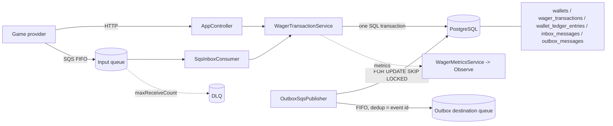

# Distributed Wagering Processor

   

A backend service that applies betting transactions (`BET`, `WIN`, `LOSS`, `REFUND`, `ROLLBACK`) to player wallets
exactly once, even when providers retry, messages are redelivered, or several instances run concurrently.
It was built for the Jungle Gaming backend challenge, using six `*_Version2.md` requirement documents (kept outside
this repository) and the official challenge README as the specification.

**The problem.** Game providers deliver transactions over HTTP and SQS with at-least-once semantics. A naive
implementation double-debits on retries, loses events if the broker is down after a commit, or overdraws a wallet under
concurrency. This service makes each of those cases safe by construction and tests them against real PostgreSQL and
LocalStack.

**Workflow.** A transaction arrives (HTTP `POST` or SQS message) -> idempotency is checked -> the wallet row is locked ->
balance, ledger entry, transaction record and Outbox events are written in **one SQL transaction** -> the SQS message is
ACKed only after commit -> a relay publishes the Outbox events to SQS.

**Stack:** Bun, strict TypeScript, NestJS, PostgreSQL 17 with MikroORM, AWS SQS (LocalStack locally), Docker Compose, Vitest, oxlint.

## Key engineering features

| Feature | Implementation | Why it matters |
|---|---|---|
| Exact money | API uses two-decimal strings (`"80.00"`); the database stores `bigint` minor units; `Money` value object (`src/domain/value-objects/money.ts`) rejects floats, negatives and bad scale | No rounding drift in a financial system |
| Persistent idempotency | Unique `(provider_id, idempotency_key)` and `(provider_id, external_transaction_id)`; canonical SHA-256 payload hash. Same key + same payload -> replay (`idempotentReplay: true`); different payload -> HTTP 409 | Provider retries never double-apply; misuse of a key is detected |
| Transactions and concurrency | One SQL transaction per operation; `pg_advisory_xact_lock` on the idempotency key; `FOR UPDATE` on the wallet row | Concurrent bets cannot overdraw or duplicate |
| Balance invariants | Check constraints `balance_minor >= 0` and `balance_before ± amount = balance_after`; checked arithmetic in the domain | The database refuses states the code should never produce |
| Append-only ledger | Trigger rejects `UPDATE`, `DELETE`, `TRUNCATE` on `wallet_ledger_entries` | Auditable history |
| Reconciliation | `POST /wallets/:id/reconciliation` compares stored balance with the ledger sum; reports, never repairs | Detects divergence without hiding it |
| Inbox | `inbox_messages` unique `(consumer_name, message_id)`, written in the business transaction | SQS redelivery cannot re-apply a message |
| Outbox | Events written in the business transaction; relay claims rows with `FOR UPDATE SKIP LOCKED`, publishes to a FIFO queue (`MessageDeduplicationId` = event id), then sets `published_at`; exponential backoff | No event is lost if the broker is down at commit time |
| SQS processing | ACK only after commit; business rejections are ACKed; other errors leave the message for redelivery and, after `maxReceiveCount`, the DLQ | Failures are retried, poison messages are isolated |
| Late references | `REFUND`/`ROLLBACK` without a processed reference are stored as `PENDING_REFERENCE`, retried with backoff, finally rejected with `REFERENCE_NOT_FOUND` | Tolerates out-of-order delivery |
| Observability | JSON logs (`LOG_FORMAT=text` for plain) with `correlationId`, `messageId`, `transactionId`, `walletId`, `providerId`, no amounts. Metrics: `wager_messages_consumed_total`, `wager_inbox_duplicates_total`, `wager_idempotency_conflicts_total`, `wager_reconciliation_mismatch_total`, `wager_consumer_retries_total`, `wager_outbox_publish_success_total`, `wager_outbox_publish_failure_total`, `wager_outbox_lag_ms`, `wager_dead_letter_depth`, `wager_lock_conflicts_total{kind}`, `wager_processing_duration_ms{source}` | Contention and latency are visible; metrics are pushed through `@nestjs/observe` (no `/metrics` endpoint) |
| Domain model | `src/domain`: `Wallet`, `WalletLedgerEntry`, `WagerTransaction` (guarded state transitions), `IntegrationEvent` hierarchy, `OutboxMessage`, with `create`/`open`/`rehydrate` factories | Invariants live in the domain, not only in SQL |

## Architecture



**Request lifecycle.** The controller or the consumer calls `WagerTransactionService.process()`. Inside one transaction it
takes the advisory lock, resolves idempotency, locks the wallet, applies the `Wallet` aggregate, and inserts the
transaction, ledger entry, Inbox row (SQS only) and Outbox events. Commit, then respond (HTTP) or delete the message (SQS).

**Asynchronous flow.** `OutboxSqsPublisher` claims unpublished rows, sends them to SQS and marks `published_at`.
Publication failures back off and retry up to `OUTBOX_MAX_ATTEMPTS`. The destination queue (`SQS_QUEUE_URL`) is not defined
by the reference documents; while unset, events stay in `outbox_messages`.

Details and design decisions: [ARCHITECTURE.md](./ARCHITECTURE.md). Evidence log: [IMPLEMENTATION_TRACKER.md](./IMPLEMENTATION_TRACKER.md).

## Technology stack

| Area | Tools |
|---|---|
| Runtime / language | Bun (scripts, install), Node.js (`start:prod`, process tests), strict TypeScript |
| Framework | NestJS, `@nestjs/observe` |
| Persistence | PostgreSQL 17, MikroORM 7 with migrations |
| Messaging | AWS SQS (`@aws-sdk/client-sqs`), LocalStack 4 |
| Tooling | Docker Compose, Vitest, oxlint |

## Quick start

Bun 1.x and Docker Compose.

```bash
cp -n .env.example .env          # set POSTGRES_PASSWORD
docker compose up -d postgres localstack
bun install
bun run infra:sqs                # creates wager-transactions(.fifo) and the DLQ, prints URLs
# copy the printed SQS_INBOX_QUEUE_URL and SQS_DLQ_QUEUE_URL into .env
bun run migration:up
bun run start:dev                # http://localhost:3000
```

`bun run migration:list` shows migration status. Do not run `down` on a database with data:
the migrations refuse destructive rollback when application data exists.

### Environment variables (see `.env.example`)

| Variable | Purpose |
|---|---|
| `POSTGRES_HOST/PORT/DB/USER/PASSWORD` | PostgreSQL connection |
| `AWS_REGION`, `SQS_ENDPOINT_URL` | SQS region; endpoint (LocalStack) — omit for real AWS |
| `SQS_INBOX_QUEUE_URL`, `SQS_DLQ_QUEUE_URL` | input FIFO queue and its DLQ; readiness checks the input queue |
| `SQS_QUEUE_URL` | Outbox destination. **Not defined by the reference documents**; while unset, events stay pending in `outbox_messages` |
| `SQS_CONSUMER_NAME`, `SQS_MAX_MESSAGES_PER_POLL`, `SQS_VISIBILITY_TIMEOUT_SECONDS` | consumer |
| `OUTBOX_POLL_INTERVAL_MS`, `OUTBOX_BATCH_SIZE`, `OUTBOX_MAX_ATTEMPTS`, `OUTBOX_BASE_BACKOFF_MS`, `OUTBOX_MAX_BACKOFF_MS` | relay |
| `PENDING_REFERENCE_*` | poll interval, max attempts, TTL, backoff for late references |
| `LOG_FORMAT` | `text` for plain console logs; JSON otherwise |
| `OBSERVE_APP_KEY`, `OBSERVE_APP_SECRET` | optional metrics export |

## API overview

| Method | Path | Notes |
|---|---|---|
| POST | `/wallets` | `{playerId, initialBalance:{amount,currency}}` → `{id, playerId, balance:{amount,currency}, version}`; creates the wallet (+ `OPENING` ledger credit if > 0); same player+currency again → 409 |
| GET | `/wallets/:walletId` | balance and version |
| GET | `/wallets/:walletId/ledger?cursor=&limit=` | cursor pagination, newest first |
| POST | `/wagering/transactions` | requires `Idempotency-Key` header (400 if missing) |
| GET | `/wagering/transactions/:transactionId` | 404 if unknown, 400 if not a UUID |
| GET | `/providers/:providerId/wagering/transactions/:externalTransactionId` | |
| POST | `/wallets/:walletId/reconciliation` | 200 with `{walletId, storedBalance, calculatedBalance, difference, consistent, checkedEntries}` |
| GET | `/` | template greeting string, not part of the challenge contract |
| GET | `/health/live`, `/health/ready` | readiness checks PostgreSQL and the input queue (503 if down) |

```bash
curl -s -X POST localhost:3000/wallets -H 'content-type: application/json' \
  -d '{"playerId":"11111111-1111-4111-8111-111111111111","initialBalance":{"amount":"100.00","currency":"BRL"}}'

curl -s -X POST localhost:3000/wagering/transactions \
  -H 'content-type: application/json' -H 'Idempotency-Key: bet-1' \
  -d '{"providerId":"prov","externalTransactionId":"ext-1","playerId":"11111111-1111-4111-8111-111111111111",
       "walletId":"<walletId>","roundId":"r1","gameId":"g1","kind":"BET","money":{"amount":"80.00","currency":"BRL"}}'
```

`REFUND`/`ROLLBACK` also send `referenceExternalTransactionId`. The response is
`{transactionId, status, failureCode, balance:{amount,currency}, idempotentReplay}`.

Status codes: 201 applied (200 on replay), 202 `PENDING_REFERENCE`, 422 business rejection with a `failureCode`
(e.g. `INSUFFICIENT_FUNDS`), 400 invalid input or missing header, 404 unknown resource, 409 idempotency payload
conflict or duplicate wallet, 503 (with `Retry-After`) for transient infrastructure errors. The full mapping, the
`failureCode` taxonomy and the design decisions are in [ARCHITECTURE.md](./ARCHITECTURE.md).

## Testing and verification

| Command | Tier | Needs |
|---|---|---|
| `bun run test` | unit: `Money`, domain model and rules, controller mapping (mocked service), SQS message parser | nothing |
| `bun run test:integration` | real PostgreSQL: concurrency, schema/migrations/triggers, atomic rollback, metrics; real LocalStack SQS: consumer/Inbox/ACK/DLQ, Outbox relay | PostgreSQL + LocalStack |
| `bun run test:e2e` | `app.e2e-spec.ts`: HTTP contract with a **mocked** service; `app.db.e2e-spec.ts`: HTTP with the **real** service and database | PostgreSQL + LocalStack |
| `bun run test:process` | builds `dist`, then runs independent OS processes against real PostgreSQL and LocalStack | PostgreSQL + LocalStack |
| `bun run build` / `bun run lint` / `bunx tsc --noEmit` | build, oxlint, type check | nothing |

Latest observed results (executed with real PostgreSQL and LocalStack where required; counts from the last full run,
recorded in [IMPLEMENTATION_TRACKER.md](./IMPLEMENTATION_TRACKER.md)):

- Unit 59/59, integration 23/23, E2E 10/10, process 3/3; build and `tsc --noEmit` passed; lint exits 0 with no warnings.

**Database isolation.** Schema, messaging, metrics, DB-E2E and process suites create and drop their own database
(`wagering_it_<uuid>`) and temporary FIFO queues; they never touch the `wagering` database. The exception is
`test/wagering.integration.ts`, which runs against the **configured** database and leaves uniquely identified
records: do not point it at a database you care about. Integration, E2E and process tests need loopback access to
PostgreSQL and LocalStack and fail with `EPERM` in restricted sandboxes.

## Verified behavior

- 50 concurrent same-key submissions -> one persisted transaction, 49 replays; same key with a different payload -> conflict.
- Two concurrent `BET 80.00` against `100.00` -> one `PROCESSED`, one `REJECTED`, balance `20.00`, one debit; 12 wallets in parallel behave the same.
- A forced failure inside the SQL transaction leaves no partial wallet, ledger, transaction or Outbox state; the retry commits once.
- Ledger `UPDATE`/`DELETE`/`TRUNCATE` are rejected by PostgreSQL; migrations run up -> down -> up on an empty disposable database.
- Real SQS: consume -> commit -> ACK; redelivery deduplicated by the Inbox; no ACK when the commit fails; DLQ after `maxReceiveCount`; Outbox publishes only committed events and recovers after a publication failure; two publishers drain one outbox without loss.
- Process level (`test/multi-process.process.ts`): three independent `node dist/main.js` processes with duplicate deliveries give one debit per contested wallet and a consistent ledger; a process SIGKILLed after commit and before ACK is recovered by another with no duplicate effects; SIGKILL + SIGTERM under load followed by restart converges to a consistent state.
- Lock-conflict and latency metrics are recorded under contention (`test/metrics.integration.ts`); structured log fields are asserted in the process test.
- HTTP endpoints against the real service and database.

## Known limitations

- `FAILED` exists in the schema, but no code path produces it.
- `bun run test:load` is not implemented.
- HTTP 503 mapping is tested with a simulated service error, not a real database outage.
- Metrics delivery to Observe is not verified; metrics are checked in-process.
- FIFO ordering with multiple consumers is not verified (process tests use one `MessageGroupId` per message).
- The window between SQS publication and persisting `published_at` is untested; FIFO deduplication on the event id is the intended mitigation.
- The commit-then-kill point in the process test is produced by a crash worker (`test/support/crash-worker.mjs`) that stalls after commit, then is SIGKILLed; the kill is real, the stall point is injected.
- `InboxMessage` and `OutboxMessage.scheduleRetry` exist as domain classes but are not connected to the persistence flow (the relay and Inbox use SQL).
- Migration rollback on a populated database is intentionally refused.
- Authentication is optional in the challenge and not implemented; `src/auth.guard.ts` is a no-op `APP_GUARD` extension point.
- Not a claim of production readiness: this is a challenge implementation validated locally.

## Repository navigation

| Path | Contents |
|---|---|
| `src/app.controller.ts`, `src/infrastructure-exception.filter.ts` | HTTP endpoints, 503 mapping |
| `src/application/` | `WagerTransactionService` (use case, reconciliation, pending references), `SqsInboxConsumer`, `OutboxSqsPublisher`, `WagerMetricsService`, config |
| `src/domain/` | `Money`, `Wallet`, `WagerTransaction`, ledger entry, integration events, Outbox/Inbox classes, pure rules |
| `src/database/` | MikroORM entities and reversible migrations |
| `scripts/ensure-sqs-queues.ts` | creates the LocalStack queues (`bun run infra:sqs`) |
| `test/` | integration, E2E and process suites; `test/support/` has the disposable-database helper and crash worker |
